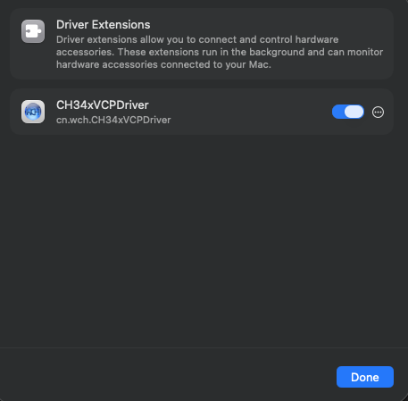

# USB setup for the CrowPanel browser workshop

Get your computer to recognize the board and make its serial port available to
the workshop. **Keep the existing firmware. Install a driver only if needed.**
You do not need Python, pip, esptool, an IDE, or a separate serial-terminal app
for this setup. The workshop runs in the browser; the operating system still
needs a working USB serial driver.

Choose your path: [macOS](#macos), [Windows](#windows), or [Linux](#linux), then
[connect in the browser](#connect-in-the-browser). If you get stuck, use the
[troubleshooting table](#troubleshooting) or [safe Codex prompt](#safe-codex-help).

## Before you start

1. Use a **known-working USB data cable** that fits the board. A charge-only
   cable can supply power without carrying data. A lit LED is not proof of a
   data connection.
2. Connect directly to the computer if possible. If an adapter is necessary,
   use a known-working data adapter. Temporarily avoid docks and unpowered hubs.
3. Leave BOOT and RESET alone. Do not install or erase firmware to fix USB setup.
4. Open the organizer's workshop URL in an up-to-date **desktop Google Chrome
   or Microsoft Edge**. Use the HTTPS site, or the organizer's local server at
   `http://localhost:PORT` (replace `PORT` with the supplied port number).
   Web Serial needs a secure context and permission to access the device.
   Ordinary HTTP on a remote computer or LAN IP is not the localhost exception.
   Do not double-click the source HTML file or bypass certificate warnings.
   [Browser documentation][chrome-serial], [secure-context standard][secure-contexts].
5. On a managed work computer, check with IT before installing drivers or
   approving extensions. Device installation and browser serial access can be
   centrally restricted. Ask for an approved driver/package or approved workshop
   machine, not a policy workaround. [Windows policy][windows-policy],
   [Edge serial policy][edge-policy].

## Understand the three checkpoints

| Checkpoint | What it means | What it does not prove |
| --- | --- | --- |
| USB device appears when plugged in | The computer can enumerate a USB device. | A serial driver is loaded or your account can open a port. |
| A corresponding COM or `/dev` serial port appears | A driver has exposed a serial interface. | The browser has permission, the port is free, or the board runs MicroPython. |
| The workshop can open that port | USB/serial access is ready for the next lesson. | The display, buttons, firmware, or Wi-Fi have passed their checks. |

Compare the device list **before and after plugging in this board** so you do
not select another accessory. Do not infer success from a screen image: this
is an e-paper board, and USB readiness is a separate check.

### Which WCH device is this?

Casey Hillers supplied the tested macOS observation **WCH USB Serial,
VID `1A86`, PID `7522`**. These are hexadecimal vendor/product identifiers;
`1a86:7522` and `USB\VID_1A86&PID_7522` express the same pair.

This is an observed setup, **not a guarantee for every CrowPanel revision**.
The IDs do not authenticate a board or, by themselves, establish its exact
bridge model or display controller. This workshop's serial and firmware
choosers currently accept only `1a86:7522`. If yours differs, record its full
IDs and ask the organizer about explicit support; do not force a different
driver or remove the chooser's filter.

Driver names are easy to confuse:

- **For the observed `1a86:7522`:** Microsoft's WCH driver catalog lists this
  hardware ID in the CH340/CH341-family package. WCH's official Windows package
  for that family is **CH341SER**. Linux's upstream **`ch341`** driver explicitly
  includes this ID. This establishes a driver-support path, not a definitive
  identification of the chip on every board. [Microsoft match][windows-match],
  [WCH package][wch-341], [Linux ID table][linux-ch341].
- **For a separately identified CH343/CH910x-family revision:** WCH provides
  **CH343SER** for Windows, including CH343, CH9101, CH9102, and other listed
  models. WCH documents standard **CDC-ACM** support on Linux for these devices,
  with its `ch343ser_linux` vendor module as an alternative for extra features.
  That is not a reason to install CH343SER for PID `7522`: WCH's published
  `ch343` ID table does not list that PID. Match the actual device and package.
  [WCH Windows family list][wch-343], [Linux guidance][wch-linux-343],
  [vendor ID table][wch-linux-343-ids].

## macOS

### 1. Check USB detection, then serial detection

1. Connect the board with the data cable.
2. Open **System Information** (search for it with Spotlight), then
   **Hardware > USB**. WCH also calls this view System Report. Look for the
   newly connected USB Serial device and inspect Vendor ID and Product ID.
   Casey's setup showed `0x1a86` and `0x7522`.
3. Open **Terminal** from Applications > Utilities. This read-only command lists
   serial callout devices without opening them:

   ```sh
   find /dev -maxdepth 1 -name 'cu.*' -print
   ```

   Run it before and after connecting. A new path might resemble
   `/dev/cu.wchusbserial...` or `/dev/cu.usbserial...`; names vary. Do not mistake
   an existing Bluetooth port for this board. WCH documents USB enumeration and
   its `wchusbserial` serial-device naming in its [macOS instructions][wch-macos].
4. If a corresponding port already exists, try the browser before installing
   anything. If USB appears but no serial port does, continue below. If USB does
   not appear at all, try another data cable/port first.

### 2. Only if needed: install or enable the official WCH driver

Use WCH's [official macOS package][wch-mac-download] or the manufacturer's
[installation instructions][wch-macos], with IT approval where required.
Follow the instructions for your macOS version. For macOS 11 and later WCH
documents opening the **CH34xVCPDriver** app and choosing **Install**; merely
copying the app is not the whole activation process. Do not install several
unrelated drivers just because their names look similar.

**Tested resolution supplied by Casey Hillers, not independently reproduced by
this guide:** the installed **CH34xVCPDriver** needed enabling in
**System Settings > General > Login Items & Extensions > Driver Extensions**.
Open that category (or its information button), locate the matching driver,
and enable it only if permitted. Labels and location can differ by macOS
version; Apple documents the Extensions area and a Drivers category.
[Apple settings reference][apple-extensions].

Casey's screenshots show the relevant row and the enabled driver dialog:




The extension-list image is cropped to exclude unrelated applications. The blue
switch shows this Mac's existing state; it is not a check of your own computer.

To inspect activation without changing anything, run:

```sh
systemextensionsctl list
```

Casey supplied these observed identifiers and status transition:

```text
Team ID:    5JZGQTGU4W
Bundle ID:  cn.wch.CH34xVCPDriver
Before:     activated waiting for user
After:      activated enabled
```

On that machine, “waiting for user” meant approval was still pending; enabling
the extension resolved it. These identifiers describe that tested installation,
not an instruction to trust arbitrary downloads or an expected result on every
Mac. Do not use activation-reset commands, disable SIP/Gatekeeper, or reduce
startup security. If approval is locked or the identity is unexpected, ask IT.

Reconnect the board after approval; restart only if the approved installer or
macOS requests it. Repeat the port check, then try the browser. An enabled
extension alone is not proof that the board's serial port is available.

## Windows

### 1. Find the board in Device Manager

1. Right-click **Start > Device Manager**. Expand **Ports (COM & LPT)**, if
   present. Plug in the board and watch for a new entry such as a USB serial
   device with **`(COM3)`**. Your COM number and display name may differ.
2. If no port appears, inspect **Other devices** and **Universal Serial Bus
   controllers** for a new device or warning icon. A USB entry without a COM
   port means USB detection and serial readiness are not yet the same thing.
3. Right-click the new device > **Properties > Details**. In **Property**, select
   **Hardware Ids**. Copy the complete values, including any revision/interface
   suffixes. For the observed workshop hardware, look for
   `USB\VID_1A86&PID_7522`. [Microsoft's identification steps][windows-ids].
4. Check **General > Device status** for an error and **Driver** for provider
   and version. If there is a healthy COM port, try the browser now: you may
   already have a suitable driver. Do not replace a working one just to match
   a screenshot or version number.

### 2. Only if no working COM port: obtain a matching signed driver

Have Windows search for a driver through **Update driver > Search automatically
for drivers**, using your organization's approved Windows Update process. If a
manual package is needed and permitted:

1. For the observed `VID_1A86&PID_7522`, start with WCH's official
   **[CH341SER Windows download][wch-341]**. WCH describes it as Microsoft
   digitally signed; Microsoft's catalog independently lists the hardware ID.
   The catalog entry is evidence of matching support, not a recommendation to
   pin everyone to that older version. [Matching catalog entry][windows-match].
2. For an actually identified CH343/CH910x device, consult
   **[CH343SER][wch-343]** instead. Do not assume every WCH board uses the same
   driver. That revision also needs organizer confirmation for this workshop.
3. Have Windows/IT verify that the package supports the **actual hardware IDs,
   Windows version, and processor architecture** (including ARM64 where
   applicable). An INF is the driver's device-matching metadata. Do not edit an
   INF, force an unmatched “Have Disk” model, or rely on a filename alone.
   [How Windows matches packages][windows-policy].
4. Follow the official installer or IT's deployment instructions. Verify the
   downloaded package's digital signature and expected publisher with IT; stop
   on an unsigned/unknown-publisher warning. Never disable signature enforcement,
   Memory Integrity, Secure Boot, or endpoint protection to install it.
5. Reconnect when instructed and check Device Manager again. Record the healthy
   COM port and proceed to the browser. No COM port yet? Save the error code and
   IDs for IT instead of repeatedly installing drivers.

Use WCH or IT-approved distribution, not third-party “driver updater” sites.
If the download is blocked by the corporate network, ask for an approved mirror
or software-center package; do not bypass filtering or TLS verification.

## Linux

Use the desktop browser on the Linux computer physically connected to the board,
not a browser running on a remote host/container. The following commands inspect
state; they do not install drivers, open serial ports, or change permissions.

### 1. Check USB, then the serial device

Open a terminal and compare the output before and after connecting:

```sh
lsusb
lsusb -d 1a86:7522
find /dev -maxdepth 1 \( -name 'ttyUSB*' -o -name 'ttyACM*' -o -name 'ttyCH*' \) -ls
```

`lsusb` lists USB devices; a line containing `ID 1a86:7522` matches the observed
pair. The filtered command being empty does not exclude a different revision:
inspect the full list too. If `lsusb` is unavailable, ask IT about your
distribution's approved USB inspection tools; do not install random scripts.

For **`1a86:7522`**, the upstream Linux `ch341` driver's ID table includes the
device; expect a port such as **`/dev/ttyUSB0`** when that driver binds.
The entry is also present in [current upstream source][linux-ch341-current].
Kernel age, distribution backports, and configuration still matter; these
checks do not establish the first supported kernel release. Prefer the
distribution's supported driver/kernel path over building a vendor module.
[Upstream Linux source, pinned to v6.12][linux-ch341].

For **CH343/CH910x CDC devices**, WCH documents the built-in `cdc-acm` route,
usually **`/dev/ttyACM0`**. Its optional vendor module uses names such as
`/dev/ttyCH343USB0`. These names are examples, not identification proof.
Do not replace a working CDC driver for this workshop's ordinary serial use.
Do not follow vendor module unloading/build/install steps as a beginner USB fix.
[WCH's Linux explanation][wch-linux-343].

If USB appears but no serial node does, read the recent kernel messages if
your normal account is allowed:

```sh
journalctl -k -b -n 80 --no-pager
```

On systems without that journal, try `dmesg | tail -n 80`. Access may be
restricted; an access-denied message is a reason to ask IT, not to weaken log
protections. Look for the plug-in event, driver binding, assigned tty name, or
errors. Share only relevant lines; logs can contain unrelated device details.

### 2. Check your account's serial permissions

Once you know the actual new port, substitute its path below:

```sh
ls -l /dev/ttyUSB0
id
udevadm info --query=property --name=/dev/ttyUSB0
```

The long listing shows owner, group, and permissions; `id` shows your current
groups. The udev properties can help correlate the tty with its USB parent.
Where available, `getfacl /dev/ttyUSB0` shows additional access-control entries.
These inspect metadata, not serial data.

**Group names are distribution-dependent.** Ubuntu commonly uses `dialout`;
Arch documents `uucp` for serial devices. Some systems grant access through
session ACLs instead. Do not blindly join both groups or the `tty` group.
[Ubuntu guidance][ubuntu-serial], [Arch group reference][arch-groups].

If permission is missing, ask IT/admin to apply the distribution's supported,
least-privilege group or device-specific access rule. Group membership changes
normally require a full logout/login and restarting the browser to take effect.
Check `id` again afterward. **Do not use `chmod 666`, world-writable udev rules,
or a browser run as root. Do not disable SELinux/AppArmor, Secure Boot, or other
protections.**

If permissions look correct but access still fails, a confined browser package
or another process may be involved. Ask IT to inspect that specific case; do
not remove confinement, uninstall accessibility services, or globally disable
ModemManager/other services as a blanket fix.

## Connect in the browser

1. Open the workshop as a normal top-level tab in desktop Chrome or Edge, using
   its HTTPS URL or the organizer's localhost server. Do not use a phone,
   embedded preview, or an unrelated Web Serial demo to test this board.
2. Close other workshop tabs, serial monitors, IDE connections, and firmware
   tools that might own the port. Use only one connection at a time.
3. Follow the host-setup lesson and click **Check USB connection**. Your current
   desktop OS guide opens automatically, with the other OS guides still available.
   A user click opens the browser's chooser; select this board's matching port,
   then confirm access. This validates the USB ID without opening the serial port
   or changing the board, and unlocks Next. Permission is site-specific and may need granting again for
   another URL/profile. [Web Serial permission and filter behavior][chrome-serial].
4. If the chooser is empty but the OS has a healthy port, recheck the actual
   USB IDs against the workshop's `1a86:7522` filter. Check site serial permission
   and managed policy with IT. Read-only policy viewers are `chrome://policy`
   and `edge://policy`; do not edit registry or managed settings to bypass a block.
   [Edge's serial access policy][edge-policy].
5. **Stop driver troubleshooting when the matching serial port is accessible.**
   Continue to **Board check** (`#verify`), the single setup/control check. It
   checks the factory demo before offering a confirmed
   MicroPython install and the five-control program.
   Already-MicroPython boards skip flashing. A subsequent
   “no MicroPython response” error is not proof of a broken USB driver; preserve
   factory firmware and ask the organizer about the next lesson.

This guide does not authorize a firmware installation, factory erase, filesystem
write, or saving `main.py`. Already-MicroPython boards do not need reflashing
just to complete host setup. Optional firmware installation is a separate,
explicitly confirmed workshop action.

## After USB setup

The course totals 120 minutes: Welcome (10), Host setup (10), Board check (20),
automatic Snake (30), Station MAC (5), Slideshow (15), Weather (20), Finish (10).
The first coding exercise fills Snake's `handle_input` TODOs; a full solution is
available with confirmation before replacing learner work. There is no Hello or
duplicate input-check course route. `device/examples/05_inputs.py` remains a
standalone, display-independent facilitator diagnostic.

Snake: **Press starts**, not a single step. **Up ↺ counterclockwise -1** (12→9→6→3),
**Down ↻ clockwise +1** (12→3→6→9), **Menu resets to ready**, **Back exits**.
Square 8×8 grid (~82px) left on 250×122; score, status and instructions right.
Food starts one move ahead and stays near the center when free cells allow.
Press replays after a collision; the session accepts inputs for five minutes,
not just until the first game over. After expiry, click Run in RAM again.
Default `STEP_MS=5000` is 5 seconds of stable viewing time after each completed refresh; the physical
full refresh takes additional time. One step per
completed frame (one cell), no catch-up bursts. Allow one 90-degree steering turn
per movement frame; extra turns queue for following frames. No smooth, fast or partial refresh promised.
Keep the driver's minimum refresh interval. For optional `show(on_wait=...)`,
reinstall the latest workshop libraries via **Board check → advanced install**,
**not reflash**. It collects debounced controls during blocking waits; the
callback must not issue another display call or modify the canvas. The refresh
waveform stays unchanged.

During Board check, browser emoji indicators observe one complete press/release
cycle for each of five controls. Browser confetti requires all five cycles, the
successful `DISPLAY CELEBRATION SHOWN` marker, and explicit user confirmation of
the physical party screen. Counts or a marker alone are not hardware PASS.
The e-paper party is a static drawing with one final refresh, not animation.

Weather uses inline `WIFI_SSID = "Guest-AccessNG"` and `WIFI_PASSWORD = ""`;
the empty password means open Wi-Fi. There is no separate app Wi-Fi form.
Optional private credentials are visible in the editor and downloads, never
browser storage or logs. Remove them from drafts, downloads and any device files
before sharing. Keep bounded connection attempts, clock synchronization and TLS
verification. MAC registration does not add enterprise 802.1X or captive-portal
support; use an approved compatible 2.4 GHz network.

Finish includes future project ideas and cleanup. For a USB battery pack, check
low-current support; before an internal battery, verify the exact board manual,
voltage, connector polarity, charging support and protection. Never connect an
unprotected bare cell.

### BOOT and RESET are for later

BOOT selects a boot/download mode in the appropriate board-specific sequence;
RESET restarts the board. Neither installs a computer's USB driver or approves
a browser/OS permission. Do not hold them during ordinary connection setup.
Use them only when a later firmware/recovery lesson or the organizer explicitly
instructs you. They are not ordinary application inputs for the control tests.

## Troubleshooting

| Symptom | Next safe step |
| --- | --- |
| Power/LED but no new USB device | Swap to a known data cable, try another direct port/adapter, then ask the organizer. |
| USB device visible, no COM/tty port | Inspect device IDs, driver status, and macOS extension approval; choose only the matching official driver if needed. |
| Linux tty exists but permission denied | Inspect owner/group/ACLs and current groups; request the distro-approved access change from IT. |
| OS port exists, browser has no chooser | Check desktop browser, secure context, site permission, and managed policy. |
| Chooser appears but board is absent | Compare actual USB IDs with `1a86:7522`; ask about revision support. |
| Port is busy or cannot open | Disconnect other tabs/tools; retry with one owner. Do not kill unknown system services. |
| Serial opens, lesson gets no expected firmware response | USB access is ready; stop changing drivers and return to firmware verification without erasing anything. |
| Blank or unchanged display | Do not use it as a USB driver test; report it separately to the organizer. |

When asking for help, include OS/version and architecture, browser/version and
workshop origin, actual VID/PID, COM/tty path if present, exact error, and whether
USB detection changed with another data cable. Redact usernames, serial numbers,
unrelated devices, and internal URLs when sharing outside your organization.
Never include Wi-Fi credentials, tokens, or full unreviewed system logs.

## Safe Codex help

Copy this prompt into an approved Codex session. It is optional; do not install
Codex or Python just to attend the workshop.

```text
Help me diagnose USB serial access for a browser-only CrowPanel workshop.
First ask my OS/version, architecture, browser/version, whether this is a
managed corporate machine, and what I see when plugging in the board.
Expected observed workshop USB ID is WCH 1a86:7522, but do not assume the
exact bridge model or that every revision matches. The workshop chooser
currently accepts only that pair. Preserve the board's existing firmware.

Work in order: known data cable/direct port -> USB enumeration -> serial
driver/port -> account permissions -> browser secure context/site permission
and managed policy. Explain each result in beginner-friendly language.

Only run read-only diagnostic commands appropriate to my OS and available
tools, and explain them first. Examples: macOS system_profiler SPUSBDataType,
systemextensionsctl list, and listing /dev/cu.*; Windows Device Manager
inspection or Get-PnpDevice -PresentOnly; Linux lsusb, listing ttyUSB/ttyACM,
id, udevadm info, getfacl, and kernel-log queries if already permitted.
Do not open/write a serial port, send commands, or toggle DTR/RTS during
command-line diagnosis. Ask me to confirm browser access manually.
Do not request elevated log access just because a query is denied.

Do not install/download-execute drivers or packages, edit files/settings,
change groups/permissions/udev rules, load/unload modules, stop services,
approve/reset extensions, reboot, or flash/erase/write firmware without
explaining the exact action and obtaining separate explicit approval first.
Never bypass corporate policy, signature checks, TLS, SIP/Gatekeeper,
Secure Boot, Memory Integrity, SELinux/AppArmor, browser confinement, or
endpoint protection. No chmod 666, world-writable rules, root browser,
random driver sites, mandatory Python tools, or blanket service removal.
If managed policy blocks progress, stop and prepare a minimal IT request.

Consult official WCH, Microsoft, Apple, Linux, distro, and browser sources
before proposing a matching driver. For PID 7522 check CH341SER Windows
support and the Linux ch341 ID table; CH343SER/CH910x and CDC-ACM guidance
apply only when supported by the actual device, not all WCH bridges.
Casey's supplied macOS resolution was enabling CH34xVCPDriver under
General > Login Items & Extensions > Driver Extensions; observed bundle
cn.wch.CH34xVCPDriver, Team ID 5JZGQTGU4W, status changing from
"activated waiting for user" to "activated enabled". Treat this as one
observed setup, not a universal guarantee or automatic trust decision.

Keep diagnostics minimal and ask me to redact sensitive output. Stop once
the corresponding serial port is accessible in the workshop browser;
do not continue into firmware installation or hardware exercises. Report
what is confirmed, what is untested, and the next safe workshop step.
```

## Sources and verification limits

Official primary sources checked October 28, 2026. Windows and Linux guidance
is source-researched, **not a claim of hands-on testing on this CrowPanel**.
The macOS identifiers, extension status transition, and successful resolution
are **user-supplied evidence from Casey Hillers**; Apple/WCH documentation
provides general guidance, not independent verification of his machine.
Driver packages and OS labels can change: use the live official instructions
and actual hardware IDs, rather than pinning to a version copied here.

- [WCH CH341SER Windows package][wch-341]: CH340/CH341-family support and Microsoft digital signing.
- [Microsoft Update Catalog hardware-ID match][windows-match]: published WCH package explicitly lists `usb\vid_1a86&pid_7522`.
- [WCH CH343SER Windows package][wch-343]: distinct CH343/CH910x and related model support, with Microsoft digital signing.
- [Microsoft hardware-ID inspection][windows-ids] and [driver matching/policy][windows-policy].
- [Upstream Linux `ch341` source, v6.12][linux-ch341] and [current source][linux-ch341-current]: explicit `0x1a86, 0x7522` ID-table entry; not a minimum-version claim.
- [WCH Linux CH343/CH910x guidance][wch-linux-343] and [vendor source ID table][wch-linux-343-ids].
- [WCH macOS instructions][wch-macos] and [official macOS package][wch-mac-download].
- [Apple Login Items & Extensions settings][apple-extensions].
- [Ubuntu serial permission guidance][ubuntu-serial] and [Arch group reference][arch-groups]: distro-specific examples, not universal group assignments.
- [Chrome Web Serial documentation][chrome-serial], [W3C secure contexts][secure-contexts], and [Edge serial policy][edge-policy].

[wch-341]: https://www.wch-ic.com/downloads/CH341SER_ZIP.html
[windows-match]: https://www.catalog.update.microsoft.com/ScopedViewInline.aspx?updateid=6faa33ef-5b78-469c-abac-10f990667c5f
[wch-343]: https://www.wch.cn/downloads/CH343SER_EXE.html
[windows-ids]: https://learn.microsoft.com/en-us/windows-hardware/drivers/install/hardware-ids
[windows-policy]: https://learn.microsoft.com/en-us/windows/client-management/manage-device-installation-with-group-policy
[linux-ch341]: https://github.com/torvalds/linux/blob/v6.12/drivers/usb/serial/ch341.c
[linux-ch341-current]: https://github.com/torvalds/linux/blob/master/drivers/usb/serial/ch341.c
[wch-linux-343]: https://github.com/WCHSoftGroup/ch343ser_linux
[wch-linux-343-ids]: https://github.com/WCHSoftGroup/ch343ser_linux/blob/main/driver/ch343.c
[wch-macos]: https://github.com/WCHSoftGroup/ch34xser_macos
[wch-mac-download]: https://www.wch-ic.com/downloads/CH341SER_MAC_ZIP.html
[apple-extensions]: https://support.apple.com/guide/mac-help/change-login-items-extensions-settings-mtusr003/mac
[ubuntu-serial]: https://help.ubuntu.com/community/SerialConsoleHowto
[arch-groups]: https://wiki.archlinux.org/title/Users_and_groups
[chrome-serial]: https://developer.chrome.com/docs/capabilities/serial
[secure-contexts]: https://www.w3.org/TR/secure-contexts/
[edge-policy]: https://learn.microsoft.com/en-us/deployedge/microsoft-edge-policies/defaultserialguardsetting
